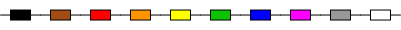

=============================
Response of a designed filter
=============================

A filter block of a system diagram runs a filter design: a Laplace transfer
with a method, made by ``sl.createIIR()`` or ``sl.createFIR()`` in a design
script in ``lib/``. Its frequency response and its impulse and step
responses show what the run computes, next to the response of the Laplace
transfer. This page describes how to plot them.

Make the filter
===============

An instruction file makes the filter from its design script:

.. code-block:: python

    FLT1 = sl.makeFilter("lib/filter_a.py", Ts="10u",
                         params=sl.selectPars("system1", circuit=["f_c"]))

``makeFilter()`` runs the design script, as a system run does. The filter
is therefore never out of date. Do not define the design a second time in
the instruction file. The design script is the design the diagram runs,
and a copy would not follow a change of it.

``makeFilter()`` fixes the sample period and the parameter values of the
response, as a SLiCAP instruction fixes its result. The traces of the
filter are then made for these values.

On a system diagram, :menuselection:`Instruction --> Make filter…` writes
this line. Its dialog lists the design scripts of the project.

Sample period
=============

- A *stationary* filter has a sample period of its own. It always uses it.
  A Ts given to ``makeFilter()`` is not used. The dialog shows the filter's
  own Ts, greyed out.
- A stationary filter can take its sample period from a parameter pin. The
  pin is then a parameter like the others, with its value in ``params``.
- A *non-stationary* filter follows the clock it runs on, and has no
  sample period of its own. Give the clock period as Ts: a number, or the
  name of a parameter in ``params``.

Parameter values
================

A design with parameters needs a value for each of them. The Make filter
dialog takes them from the parameter table of the instruction dialogs. For
each parameter you choose its source:

- **system**: the sheet parameter of a system diagram that runs the design.
  The dialog offers the diagrams whose run script lists the design script.
- **specs**: the specification item with the same name.
- **user**: a value typed in the table.

The values are read when the line runs. The dialog writes them as
``params=sl.selectPars("<diagram>", ...)``. Without a diagram the first
argument is ``None``.

A value may be an expression in other parameters of ``params``.

Errors
======

``makeFilter()`` makes something that later lines use. When it cannot be
made, it raises an error, and the script stops at the cause:

- the design script does not exist;
- the design script makes no filter, or more than one;
- a parameter has no numeric value;
- a non-stationary filter has no positive Ts.

The dialog prevents these errors: :guilabel:`Add instruction` stays
disabled until everything is given.

Traces
======

In :menuselection:`Instruction --> Create / Edit Traces and Measurements…`
choose the filter as the analysis result. Choose the domain and the range.
The dialog fills in the standard traces: in the frequency domain
``dB(mag(H_z))`` and ``dB(mag(H_s))``, in the time domain ``step``. Edit
or remove them as needed. The dialog writes the line, for instance:

.. code-block:: python

    TR1 = sl.make_traces(sl.sweepData(FLT1, "10", "50k", 200),
                         [{"y": "dB(mag(H_z))"}, {"y": "dB(mag(H_s))"}])

``sl.sweepData()`` only makes the x-y data for the range. The sample period
and the parameter values are those of ``makeFilter()``.

The signals of a filter:

- **Frequency domain:**

  - ``H_z``: the response of the filter as the run computes it, with
    z = exp(j2πf·Ts);
  - ``H_s``: the response of its Laplace transfer, with s = j2πf.

  Both are complex. ``mag(H_z)`` is the magnitude and ``dB(mag(H_z))`` the
  magnitude in dB. ``phase(H_z)`` is the phase in degrees and
  ``delay(H_z)`` the group delay. The same holds for ``H_s``.

- **Time domain**, ``sweepVar="t"``, at the sample times k·Ts:

  - ``impulse``: the response to one sample of value 1, divided by Ts. It
    then lies on the impulse response of the Laplace transfer
    (``doImpulse()``).
  - ``step``: the step response.

  The number of points is not used: the samples lie at k·Ts. They are
  drawn as points. A trace specification with a style, such as
  ``{"y": "step", "lineType": "-"}``, overrides that.

To compare two sets of values, make the filter twice, as ``FLT1`` and
``FLT2``, and plot both.

What the run computes
=====================

The traces are computed as the run computes the filter:

- A stationary IIR filter runs as a cascade of second-order and first-order
  sections.
- A non-stationary IIR filter runs as the state-space form of its whole
  transfer, stepped exactly over each tick: zoh for a held input, foh for an
  input linear between the samples. For a held step the step response at the
  sample times then equals the step response of the Laplace transfer.
- A FIR filter runs as its taps.

The transfers of the filter
===========================

``makeFilter()`` gives the filter two transfers, with every parameter value
substituted:

- ``FLT1.H_s``: the Laplace transfer, an expression in ``s``;
- ``FLT1.H_z``: the z-transfer that the run executes, an expression in
  ``z``, for the sample period ``FLT1.Ts``.

``sl.sweepData()`` evaluates them. They can also be combined, like the
``laplace`` attribute of a SLiCAP result. ``sl.sweepData()`` sweeps an
expression in ``s`` and gives it the signal ``H_s``. For instance, the
admittances of two models of one component, added:

.. code-block:: python

    Y  = FLT1.H_s + FLT2.H_s
    D3 = sl.sweepData(Y, "1k", "100M", 500)
    TR3 = sl.make_traces(D3, [{"y": "dB(mag(H_s))"}])

An expression in ``z`` needs its sample period. ``sl.z2fourier()`` turns it
into a frequency response:

.. code-block:: python

    Hf = sl.z2fourier(FLT1.H_z, FLT1.Ts)

The z-transfer is a product of first-order and second-order factors, not one
numerator and one denominator polynomial. With many poles close to z = 1, a
filter at a low frequency compared with the sample rate, the coefficients of
one polynomial lose their accuracy in floating point. The factors of a
non-stationary filter are computed with 50 digits. ``sl.sweepData()``
evaluates the factors one by one.

The attributes of the filter
============================

Set by ``createIIR()`` or ``createFIR()`` in the design script:

- ``name``, ``dataType`` ("iir" or "fir"), ``method``, and for a FIR
  filter ``window`` and ``length``;
- ``laplace``: the Laplace transfer, with the parameters as symbols;
- ``params``: the names of the parameters;
- ``stationary``;
- ``Ts``: the filter's own sample period, None for a non-stationary
  filter;
- ``ts_param``: the name of the parameter that gives Ts, or None.

Set by ``makeFilter()``:

- ``Ts``: for a non-stationary filter the clock period, for a Ts parameter
  its value;
- ``values``: the parameter values;
- ``H_s`` and ``H_z``: the transfers above.

The pins of a filter block and the link to the circuit of its design belong
to the block, not to the filter. The editor reads the circuit from the
``makeCircuit()`` line of the design script.
